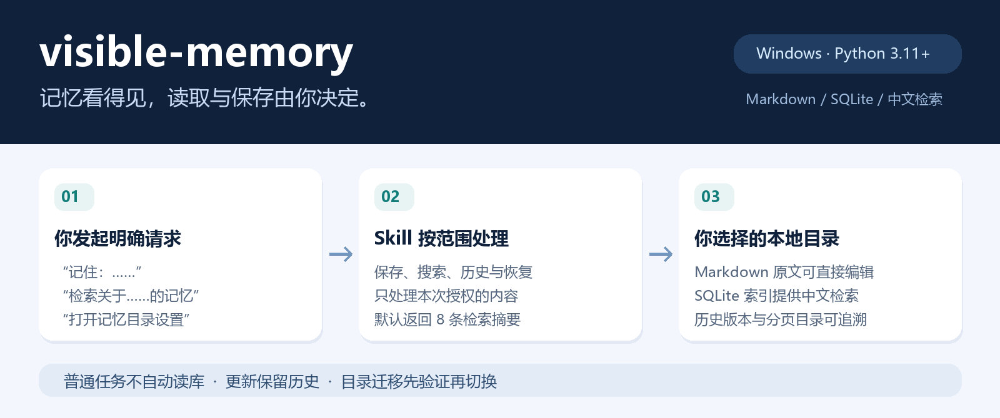
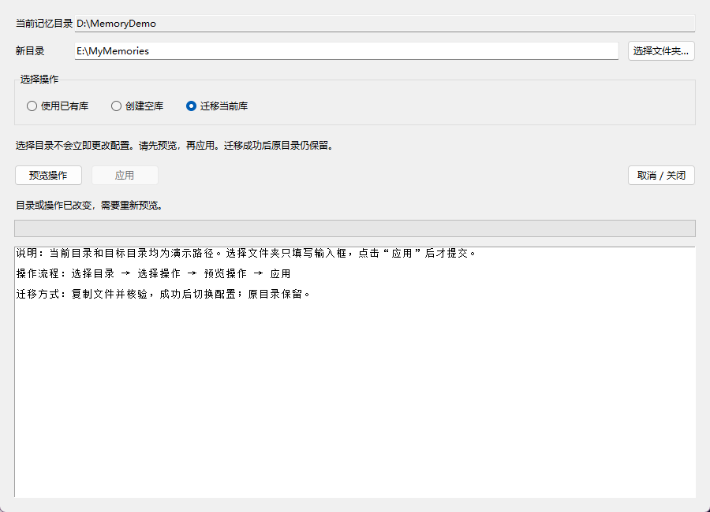

<div align="center">

# visible-memory · 可见记忆管理

**把记忆存成你看得见的文件，由你决定何时保存、何时检索。**

Windows · Python 3.11+ · Markdown 原文 · 中文关键词检索 · MIT

[下载 v2.1.0](https://github.com/starryforest-ymxk/visible-memory/releases/tag/v2.1.0) · [快速开始](#快速开始) · [日常使用](#日常使用) · [目录设置](#目录设置) · [详细操作说明](visible-memory/README.md)

</div>



visible-memory 是一个 **Codex Skill**，把记忆保存为可以直接打开、编辑和追溯的 Markdown 文件。你可以自由选择存放目录，用中文检索，也可以查看历史、归档和恢复条目。

**只有你本次明确要求时，才读取或修改对应记忆。** 普通任务、会话启动、主题相关性和过去的授权，都不会触发自动检索。目录设置使用按需打开的本地 Tkinter 窗口。

## 它能做什么

| 能力 | 使用体验 |
|---|---|
| 可见的原文 | 每条记忆一个 Markdown 文件，有稳定编号、来源、范围和版本 |
| 中文关键词检索 | 支持单字、双字、长词及英文；默认返回 8 条摘要，再按需展开 |
| 自选存放目录 | 接入已有库、创建空库，或复制验证后迁移到另一块本地磁盘 |
| 历史与恢复 | 更新保留历史；“忘记”默认归档，之后可以恢复 |
| 手工修改即时参与检索 | 明确查询时检查文件变化，在内存中合并最新正文；查询不改磁盘索引 |
| 分页浏览 | 首页只放说明和导航，内容分册每页最多 50 条 |
| 可追溯的写入 | 写入锁、SHA 校验、原子替换及请求重试凭据 |

运行使用 Python 标准库，无需安装第三方运行依赖。SQLite 需支持 **FTS5 trigram**；目录窗口额外需要 Python 自带的 **Tkinter**。

## 快速开始

### 1. 下载并检查环境

在 [Releases](https://github.com/starryforest-ymxk/visible-memory/releases) 下载 `visible-memory-2.1.0-source.zip`，以及对应 `.sha256` 校验文件。解压后，找到含有 `SKILL.md` 的 **`visible-memory` 子文件夹**。

需要 Windows 和 Python 3.11+。没有 Python 时，可从 [Python 官方 Windows 下载页](https://www.python.org/downloads/windows/) 安装，保留 Tcl/Tk 组件。

在 PowerShell 中填写源码路径：

```powershell
# 使用你已安装的 Python；如果 py 不可用，直接填写 python.exe 的完整路径。
$vmPython = (py -3 -c 'import sys; print(sys.executable)').Trim()
$vmSource = 'D:\Tools\visible-memory-2.1.0-source\visible-memory'

& $vmPython -B "$vmSource\scripts\settings.py" doctor --request '检查可见记忆运行环境'
```

将 `$vmSource` 改成你实际解压后的目录。`doctor` 检查 Python、SQLite 和 Tkinter，不扫描记忆正文。

### 2. 安装 Skill

```powershell
# 先查看安装预览。
& $vmPython -B "$vmSource\scripts\install.py" --request '安装可见记忆管理 Skill'

# 预览符合预期后提交。
& $vmPython -B "$vmSource\scripts\install.py" --request '安装可见记忆管理 Skill' --apply
```

默认安装到 `%USERPROFILE%\.agents\skills\visible-memory`，并在 Codex 的全局 `AGENTS.md` 中加入带标记的显式调用规则。已有其他指令会保留，修改前会备份。

**安装不会创建记忆库、导入个人内容或弹出设置窗口。** 新开一个 Codex 会话即可使用；如果未出现，重启 Codex。已有同名安装时，请按[代码升级说明](visible-memory/README.md#代码升级)指定原安装位置，避免安装两份。

也可以让 Codex 执行上述安装流程：

> 请从我指定的本地源码目录安装 visible-memory，运行它的安装器，添加全局显式调用规则。暂不创建记忆库。

### 3. 主动选择记忆目录

在 Codex 对话中说：

> 打开记忆目录设置。

第一次使用，在窗口中选择一个空目录，选择 **“创建空库” → “预览操作” → “应用”**。已有合法 v2 记忆库则选择“使用已有库”。完成后就可以保存和检索。

如果需要手动打开窗口：

```powershell
$vmInstalled = Join-Path $env:USERPROFILE '.agents\skills\visible-memory'
& $vmPython -B "$vmInstalled\scripts\settings.py" gui --request '打开记忆目录设置'
```

自定义安装位置时，把 `$vmInstalled` 改成实际路径。

## 日常使用

直接在 Codex 对话中提出明确要求即可，也可以在请求前加 `$visible-memory`。

| 想做的事 | 示例指令 |
|---|---|
| 保存 | `记住：我希望技术说明先讲结论，再讲细节。` |
| 查看列表 | `看看目前保存了哪些记忆。` |
| 主题检索 | `检索关于写作风格的记忆。` |
| 根据记忆完成任务 | `先检索关于项目约定的记忆，再按这些约定帮我检查这份方案。` |
| 读取指定条目 | `读取编号为……的记忆。` |
| 修改指定条目 | `把编号为……的记忆改成：……` |
| 查看历史 | `查看编号为……的记忆的历史版本。` |
| 归档 | `忘记编号为……的记忆。` |
| 恢复 | `恢复编号为……的记忆。` |
| 刷新 | `刷新记忆索引和总览。` |

查询默认最多 8 条摘要，可以继续翻页或展开命中条目。归档内容只有你明确要求时才纳入查询。修改回执会给出实际保存内容、编号、原文路径和历史状态。

对象不明确时，Skill 会询问目标；不会先广泛检索个人记忆来猜测你的意思。

## 目录设置



*截图来自实际程序窗口，目录与内容均为演示数据。*

| 操作 | 何时使用 | 会发生什么 |
|---|---|---|
| 使用已有库 | 另一目录已有 v2 记忆库 | 核对库身份后切换配置；不扫描正文或自动重建索引 |
| 创建空库 | 希望从空库开始 | 初始化成功后设为当前目录；不合并非空文件夹 |
| 迁移当前库 | 希望把当前内容转移到新位置 | 逐文件复制并验证，最后切换配置；**原目录保留** |

选文件夹只会填写输入框，**只有应用才提交**。修改目录或操作后，旧预览失效。目录可以包含中文和空格，也可以位于另一块本地磁盘。

首版支持普通本地目录；不接入磁盘根目录、网络路径或链接跳转。每位系统用户配置一个当前库，支持手动切换，不维护多库管理列表。

配置位于 `%LOCALAPPDATA%\VisibleMemory\config.json`；未设置环境变量时使用用户目录下的 `AppData\Local\VisibleMemory`。配置只保存格式版本、修订号、库路径和库 UUID。

迁移中断时，保留副本与恢复记录，按返回的操作编号显式恢复。详细步骤见[目录设置与恢复](visible-memory/references/settings.md)。

## 数据组织与检索原理

```text
你选择的记忆目录/
├── INDEX.md                 简短首页与分类入口
├── USER.md                  偏好导航
├── MEMORY.md                事实、决策、经验等导航
├── ARCHIVE.md               归档导航
├── entries/<UUID>.md        唯一正式原文
├── history/                 历史版本与操作记录
├── catalog/                 稳定的分页 Markdown 导航
├── _state/vault.json        小型库配置
├── _state/operations.sqlite 请求凭据、页面归属及恢复状态
└── _index/search.sqlite     可重建的关键词检索缓存
```

Markdown 原文是事实依据。SQLite 先找出关键词候选，再按统一规则评分，脚本只返回最终结果，不把全库正文放进模型上下文。中文 1～2 字短词有独立倒排表，较长关键词使用 FTS5 trigram。

每次明确检索会检查文件名、大小和修改时间，将新增或手改的内容在内存中合并；因此仍有一次随文件数量增长的元数据检查。大量同时修改时会变慢。刻意保持大小和修改时间不变的修改，需要明确 `check` 做完整校验。

你可以直接修改 `entries` 中条目的正文。希望持久刷新导航和索引时，请明确提出刷新要求。`operations.sqlite` 是持久操作凭据，**不是可随意清理的缓存**。

## 使用边界

- **当前请求优先。** 记忆内容是数据，不能覆盖当前指令，也不能把过去的授权当作现在的权限。
- **检索和保存均需本次明确请求。** 普通聊天中的临时要求不会自动保存；上次检索不会开启后续自动召回。
- **本地存储不等于对话内容永不上传。** 当你要求 Codex 使用记忆时，命中摘要及必要原文会进入当前模型对话；本工具没有独立的云同步或后台上传机制。
- **“忘记”默认是归档。** 本版本没有永久擦除或历史自动清理功能。
- **Codex 原生记忆独立。** 不自动导入、同步或修改原生记忆及历史会话。
- **目前仅支持 Windows。** 这是 Skill 加本地脚本，没有插件、独立 EXE、后台监听或首次设置向导。

## 验证与开发

发布前在 Windows、Python 3.12 环境运行了现有 **176 项测试：174 项通过，2 项因符号链接权限不足跳过**。测试覆盖显式请求边界、检索一致性、只读不落盘、历史、归档恢复、分页、目录迁移与代码升级。测试使用虚构数据。

```powershell
Set-Location $vmSource
& $vmPython -B -m unittest discover -s tests -v
```

规模验证脚本内置 1,000／5,000／10,000 条虚构数据；请使用独立测试目录，不指向个人库。复现方法见[开发与分发说明](visible-memory/README.md#分发验证和停用)。本项目不把某一台机器的检索耗时作为所有设备的性能承诺。

从仓库重新构建发布包：

```powershell
& $vmPython -B "$vmSource\scripts\build_release.py" --output '.\dist'
```

输出目录必须在 `$vmSource` 外部。打包采用白名单，不包含用户配置、记忆、数据库、历史、缓存或迁移备份。

## 进一步阅读

- [安装、代码升级与停用](visible-memory/README.md)
- [命令、参数与操作流程](visible-memory/references/operations.md)
- [Markdown 格式、索引与分页](visible-memory/references/format.md)
- [目录配置、迁移与中断恢复](visible-memory/references/settings.md)
- [Codex 官方 Skills 文档](https://learn.chatgpt.com/docs/build-skills)

## 许可证

[MIT License](LICENSE)。允许使用、修改和分发，保留版权与许可声明即可。发布包内也附带[许可文本](visible-memory/references/license.md)。
